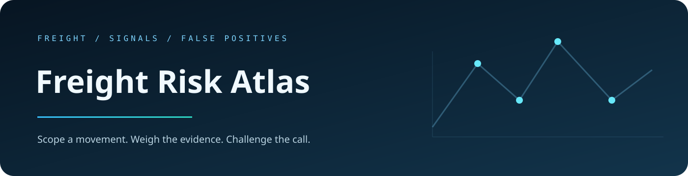
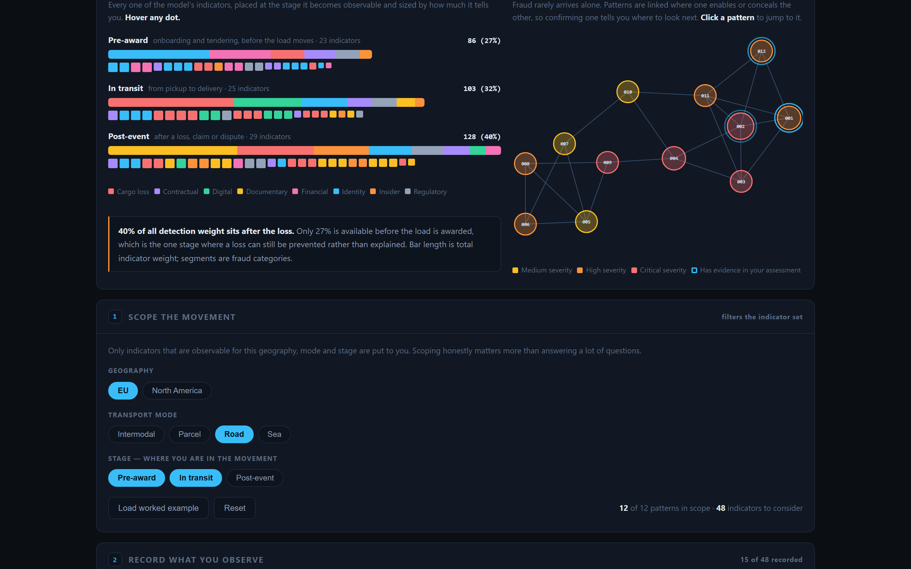
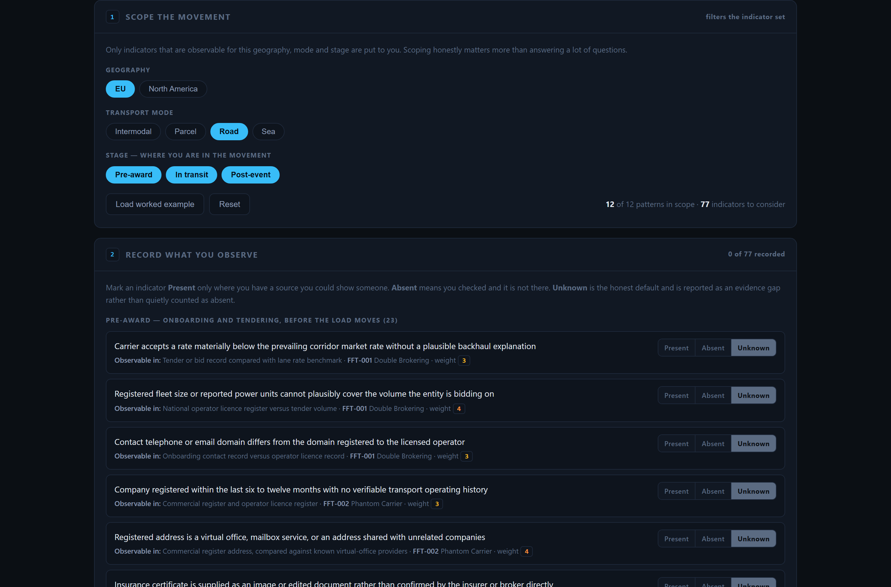
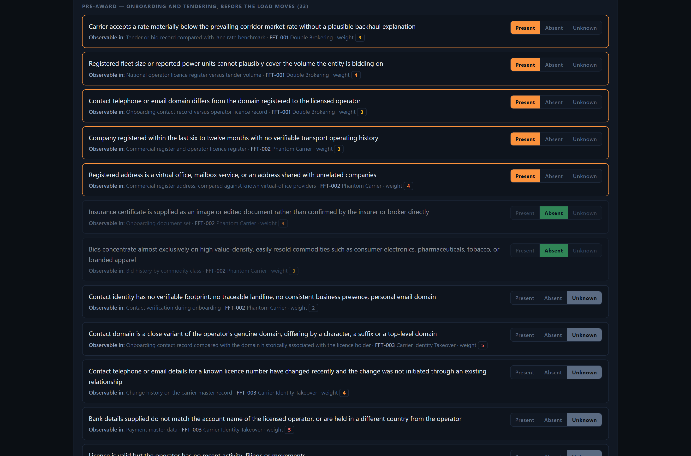
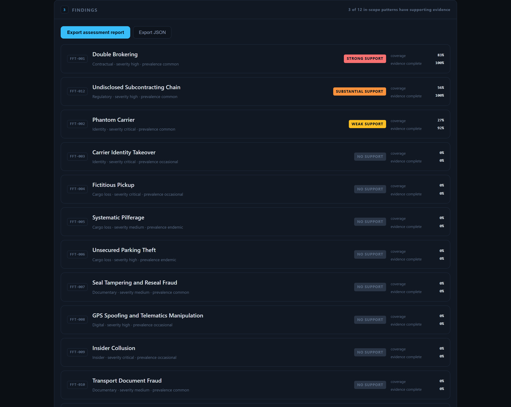
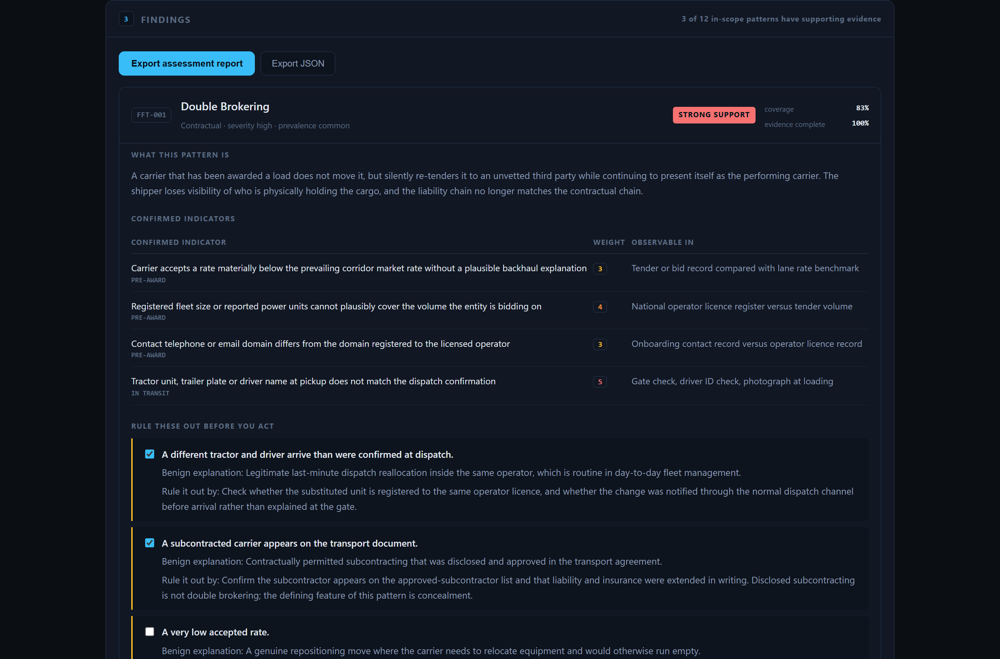

<p align="center">
  
</p>

<p align="center">
  <a href="https://jeevan-0508.github.io/freight-risk-atlas/">Open the live tool</a> ·
  <a href="#the-assessment-flow">Assessment flow</a> ·
  <a href="#run-locally">Run locally</a>
</p>

# Freight Risk Atlas

### A browser-first assessment engine for freight and carrier fraud risk.

Freight Risk Atlas helps you scope a movement, record what you can actually observe, test which patterns the evidence supports, and keep the false positives and countermeasures beside the finding.

`FREIGHT RISK` · `OBSERVABLE SIGNALS` · `FALSE POSITIVES` · `BROWSER-ONLY`

## Start with the tool

**[Open Freight Risk Atlas →](https://jeevan-0508.github.io/freight-risk-atlas/)**

The tool starts with the full risk landscape, then narrows into a movement-specific assessment. It is designed to support a defensible next question—not to turn a weak signal into a verdict.

## The assessment flow

<p align="center"></p>

<table>
  <tr>
    <td width="50%"><br><strong>1 · Scope the movement</strong><br>Set the lane, stage, and context before interpreting a signal.</td>
    <td width="50%"><br><strong>2 · Record observations</strong><br>Work from what is observable rather than assumed.</td>
  </tr>
  <tr>
    <td width="50%"><br><strong>3 · Review findings</strong><br>See which patterns the evidence supports and what remains uncertain.</td>
    <td width="50%"><br><strong>4 · Challenge the call</strong><br>Rule out benign explanations before escalating a case.</td>
  </tr>
</table>

## Why it matters

The most expensive fraud mistakes are often confident wrong calls. Atlas keeps the innocent explanation, the intervention point, and the next useful observation close to the same screen as the suspicion.

<details>
<summary><strong>Model scope</strong></summary>

The taxonomy and assessment model cover European road-freight scenarios. The tool is an open assessment aid, not a production fraud detector, legal opinion, or guarantee of loss prevention.

</details>

## Run locally

No backend is required. Serve the repository with any static file server:

```bash
python3 -m http.server 4173
```

## Related systems

[Fraud Watch](https://github.com/Jeevan-0508/fraud-watch) · [Freight Fraud Taxonomy](https://github.com/Jeevan-0508/freight-fraud-taxonomy) · [RISK//MESH](https://github.com/Jeevan-0508/Risk-Mesh)

<p align="center"><sub>Built by <a href="https://github.com/Jeevan-0508">Jeevan Siddhabhaktula</a> · MIT licensed</sub></p>
